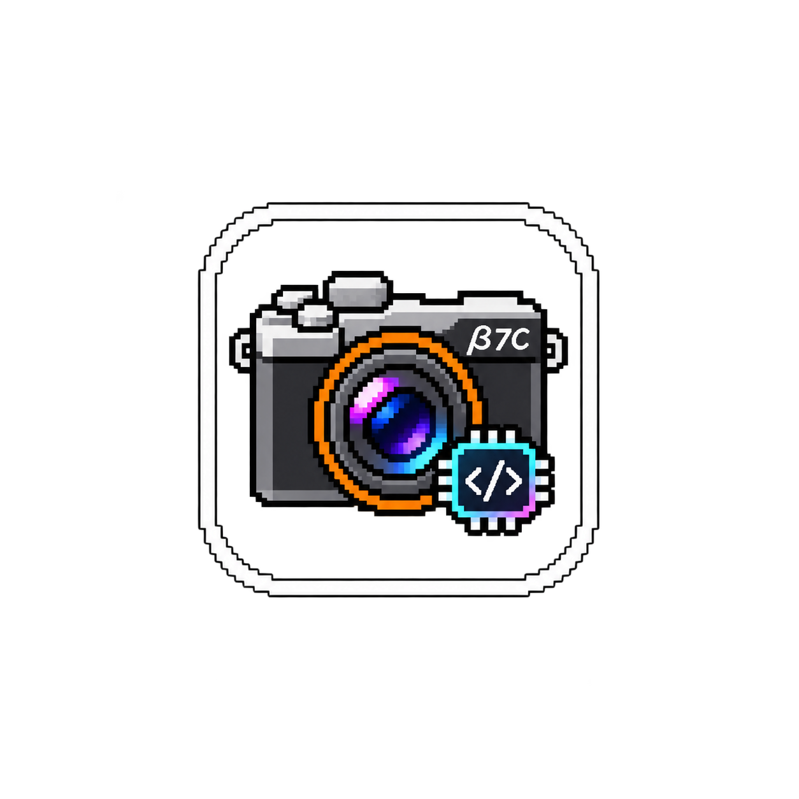

<p align="center">
  
</p>

<h1 align="center">beta7compact</h1>

<p align="center">
  Sony α7C의 사진을 폰으로 가져와, 나만의 필름 레시피로.<br>
  원본은 보존하고 보정 결과는 새로운 JPEG로 저장합니다.
</p>

<p align="center">
  <a href="https://github.com/SukbeomH/beta7compact/releases/latest">최신 APK 다운로드</a> ·
  <a href="#시작하기">시작하기</a> ·
  <a href="#검증-상태">검증 상태</a> ·
  <a href="CHANGELOG.md">변경 이력</a>
</p>

---

**0.7.1** · Android 10 이상(API 29+) · Sony α7C 1세대(ILCE-7C) 대상

Galaxy Z Fold 계열 폰을 중심으로 만든 개인용 카메라 동반 앱입니다. USB로 사진을 가져오고, LUT와 세부 보정을 적용해 저장하거나 레시피를 공유할 수 있습니다. 현재 원격 촬영과 카메라 펌웨어 변경 기능은 제공하지 않습니다.

## 시작하기

1. [GitHub 릴리즈](https://github.com/SukbeomH/beta7compact/releases/latest)에서 APK를 내려받아 설치합니다.
2. 카메라의 USB 연결 모드를 **MTP**로 설정하고 데이터 전송 케이블로 폰과 연결합니다. USB 권한을 허용합니다.
3. **카메라 → 새 사진 N장 가져오기**를 누릅니다. 필요한 사진만 선택해 가져올 수도 있습니다.
4. **사진 → 편집**에서 LUT와 보정값을 조절합니다. 사진을 길게 누르면 원본과 비교합니다.
5. **저장**을 누르면 `DCIM/beta7compact/Recipes/`에 새 JPEG가 생성됩니다.

마음에 드는 보정값은 **레시피로 보관**합니다. 사진 탭의 선택 모드에서는 여러 장에 같은 레시피를 적용할 수 있습니다.

> 기존 앱은 삭제하지 않고 업데이트하세요. **0.5.0은 서명 불일치가 있어 사용하지 않습니다.** 0.5.1부터 기존 설치본의 서명키로 배포합니다. 서명 오류가 나면 앱을 삭제하지 말고 [서명키 관리 문서](docs/SIGNING.md)를 확인하세요.

## 주요 기능

| 기능 | 할 수 있는 일 |
| --- | --- |
| USB 사진 가져오기 | JPEG·ARW·HIF 목록 조회, 선택·일괄 가져오기, RAW+JPEG 쌍 처리, 완료 파일을 건너뛰는 재개 |
| 중복 확인·원본 보존 | 파일 내용의 SHA-256으로 중복 판정, 원본 바이트를 유지해 갤러리에 저장 |
| 사진 라이브러리 | 필터, 다중 선택, 레시피 일괄 적용, 원본과 보정 결과 연결 |
| 필름 레시피 | 내장 LUT 27종, 사용자 `.cube`, 강도·화이트밸런스·노출·그레인·비네트 |
| 세부 편집 | RGB·채널별 톤커브, HSL 8색, 하이라이트·섀도, 대비·채도·바이브런스, 스플릿 톤, 실행 취소·다시 실행 |
| 레시피 공유 | `b7c1:` 텍스트, QR 표시, 현재 색 설정을 `.cube`로 내보내기 |
| 폴더블 화면 | 카메라·사진·레시피·설정 4탭, 화면 크기와 자세에 따른 배치, 미저장 편집 이탈 확인 |
| 진단·업데이트 | 개인정보를 제외한 고정 이벤트 로그 공유, GitHub 릴리즈 확인·APK 내려받기 |

ARW 편집은 현재 **내장 미리보기 JPEG**를 사용합니다. RAW 센서 데이터의 직접 현상은 아직 제공하지 않습니다. S-Log3 JPEG 입력 변환은 선택 기능이며 기본값은 꺼짐입니다.

### 읽기 전용 연구 기능

설정에서 일반 사진 작업과 별도로 사용할 수 있습니다.

- **카메라 지원 정보:** USB VID/PID·인터페이스·엔드포인트·권한·실패 단계와 지원 명령·속성 목록을 확인합니다. 카메라 모드는 직접 선택해 기록하며, 화면에서 확인한 진단 결과를 Android 공유 메뉴로 보낼 수 있습니다. 기기가 보낸 모델·버전 문자열은 화면에만 표시하고 공유에서는 제외합니다. 목록에 있다는 사실만으로 제어 성공을 보장하지 않습니다.
- **로컬 파일 분석:** 선택한 파일의 크기·SHA-256·첫 64바이트를 표시합니다. 카메라에서 펌웨어를 추출하거나 수정하지 않습니다. 해시도 정품·모델 호환성을 판정하지 않습니다.

분석 결과는 자동 저장하거나 공유 진단 로그에 넣지 않습니다. 자세한 범위는 [개발 계획](docs/PLAN_A7C_EXTENSIONS.md)과 [Sony 공식 지원 조사](docs/SONY_SUPPORT_RESEARCH.md)를 참고하세요.

## PC Remote 실험 진단

**설정 → 연구 · PC Remote 실험 → PC Remote 실험 진단**에서 실행합니다. 카메라의 스마트폰 제어를 끄고 PC Remote를 켠 뒤 연결 방법을 USB로 선택하세요. USB 권한을 허용하고 안내 확인란을 선택한 후 실행합니다.

이 기능은 Sony 연결 협상 → 속성 조회 → 짧은 이벤트 관찰 → 종료를 시도합니다. **연결 과정에서 카메라 모드가 바뀔 수 있으며**, 종료 뒤 MTP 가져오기로 돌아가려면 카메라 설정 변경이나 재연결이 필요할 수 있습니다. 촬영·노출 설정 쓰기·펌웨어 명령은 보내지 않습니다.

화면의 접고 펼치는 안내에서 설정·테스트 순서·로그 공유 항목·MTP 복귀 방법을 확인할 수 있습니다. 진단 뒤에는 결과에 맞는 해석을 함께 표시합니다.

실패해도 결과를 지우기 전에 **로그 공유**로 미리보기 내용을 보내주세요. 실패 단계·PTP 응답·프로토콜 버전·미지원 속성 타입·종료 상태를 기록하며 원시 패킷·시리얼·기기 문자열·사진은 제외합니다. 실제 α7C 동작은 아직 확인하지 않았습니다. [실험 진단 안내](docs/PC_REMOTE_DIAGNOSTICS.md).

## 검증 상태

**구현·자동 테스트와 실제 기기 확인을 구분합니다.**

| 항목 | 확인 범위 |
| --- | --- |
| USB 가져오기·레시피 편집 | Galaxy Z Fold8(Android 17) + α7C fw 2.03에서 확인한 이력 있음 |
| 0.6.0 기능 테스트 | debug·release 각각 196개 단위 테스트 통과, Room 마이그레이션 검사 통과 |
| 0.7.0 실험 진단 | debug·release 각각 281개 테스트, 빌드·lint·기존 인증서 일치 검사 통과. 폰/카메라 실기 확인은 추후 진행 |
| 0.5.2 빌드·서명 | APK 빌드·lint 통과, 기존 설치본과 인증서 일치 확인. 아이콘·버전 변경으로 단위 테스트는 재실행하지 않음 |
| 0.5.2 실제 설치·아이콘 | 연결된 폰에서 삭제 없이 업데이트 성공. 런처 앱 서랍·Finder에서 테두리 제거, 확대, 잘림 없음 확인 |
| 앱 내 업데이트 | APK 내려받기 확인. 수정된 APK의 업데이트 설치는 ADB로 확인했으며 앱 내 설치 전체 흐름은 추가 확인 필요 |
| USB 진단·공유 | 구현·자동 테스트 완료. 폰에서 미연결 결과·Android 공유 메뉴 확인. α7C 실기 통신은 확인 예정 |
| 로컬 파일 분석 | 구현·자동 테스트 완료, 폰의 파일 선택·분석 취소 실기 확인 예정 |

다른 폴더블 화면 상태·테마·런처 마스크는 모두 확인한 상태가 아닙니다. 아이콘의 monochrome 레이어는 미제공입니다.

- [MTP·PC Remote 진단 사용법](docs/CAMERA_DIAGNOSTICS.md)
- [빌드·테스트 기록과 알려진 한계](docs/verification/2026-11-17/README.md)
- [0.5.2 실제 런처 검증](docs/verification/2026-11-17/launcher-0.5.2.md)

### 보류·후속 계획

- **BLE 위치 동기화:** 구현과 패킷 테스트는 있으나 실기에서 카메라 광고 미검출로 보류. [프로토콜 근거](docs/BLE-LOCATION.md)
- **RAW 직접 현상:** 계획 단계. [개발 계획](docs/TASK_M5B.md)
- **원격 촬영·설정 제어:** 모델별 프로토콜 근거와 실기 확인, 카메라 쓰기 정책 결정 후 검토.
- **카메라 내부 확장:** 앱과 분리한 연구 단계. 호스트 시뮬레이터는 카메라에서 실행되는 코드가 아닙니다.

## 데이터와 카메라 보호

- 원본 사진을 수정·덮어쓰기·삭제하지 않습니다. 보정 결과는 별도 JPEG로 저장합니다.
- USB로 카메라 사진 삭제·설정 변경·셔터 명령이나 USB 구성 변경을 보내지 않습니다.
- PC Remote 실험 진단에서만 사용자의 명시적 실행으로 Sony 모드 전환 연결 명령을 보냅니다. 기존 읽기 전용 진단은 이 명령을 보내지 않습니다.
- 공유 진단 로그는 최대 200건의 고정 이벤트만 보관합니다. MAC·좌표·파일명·해시는 포함하지 않습니다. GPS 좌표도 DB에 저장하지 않습니다.
- 사진과 DB는 폰의 앱 전용 영역과 사용자 갤러리에 저장합니다. 앱 업데이트 요청에 기기·사진 정보를 보내지 않습니다.
- 외부 라이브러리는 AndroidX·Kotlin Coroutines·테스트 도구를 사용합니다. Google Play services는 사용하지 않습니다.

개인 사진·실기 로그·기기 식별자·서명키를 공개 저장소에 올리지 마세요.

## 업데이트

**설정 → 업데이트 → 지금 확인**에서 새 버전을 확인할 수 있습니다. 자동 확인은 하루 한 번이며 설정에서 끌 수 있습니다. 내려받기가 끝나면 Android 설치 확인 화면으로 이동합니다.

업데이트 가능한 릴리즈는 다음 조건을 충족해야 합니다.

- 초안·사전 릴리즈가 아니며, `vX.Y.Z` 태그의 버전이 설치본보다 높습니다.
- APK의 `versionName`이 태그와 같고 `versionCode`가 설치본보다 높습니다.
- APK가 기존 설치본과 **같은 키로 서명**되어 있습니다.

배포에는 APK 하나를 첨부합니다. 여러 개가 있으면 앱은 첫 번째 APK를 선택합니다. 네트워크 요청은 GitHub 최신 릴리즈 조회와 APK 다운로드에 사용합니다.

## 소스에서 빌드하기

Kotlin + Jetpack Compose 앱입니다. 패키지는 `dev.sukbeomh.beta7compact`, targetSdk는 35입니다.

필요한 환경은 JDK 17 이상, Android SDK 35, Build Tools 35.0.0입니다. 이번 검증에는 JDK 21과 포함된 Gradle Wrapper 8.9를 사용했습니다. `local.properties`에 `sdk.dir`을 지정하고 커밋하지 않습니다.

```sh
./gradlew assembleDebug test lint --continue --no-daemon
python3 tools/check_m1_migration.py
python3 tools/check_m2_migration.py
```

APK 경로: `app/build/outputs/apk/debug/app-debug.apk`

과거 작업 전용 `check_m5a_contract.py`, `check_d2_contract.py`는 당시 기준 커밋·변경 금지 범위를 검사합니다. 현재 기능 확장 전체의 통과 기준으로 사용하지 않습니다.

### 배포 전 서명 확인

기본 서명키 경로는 `~/.android/debug.keystore`입니다. 다른 PC에서는 기존 키를 안전하게 복원하고 `-Pbeta7compact.signingStore=/절대/경로`로 지정합니다. 새로 생성한 키로는 기존 앱을 업데이트할 수 없습니다.

```sh
python3 tools/verify_release_apk.py app/build/outputs/apk/debug/app-debug.apk \
  --apksigner /절대/경로/android-sdk/build-tools/35.0.0/apksigner
```

검사 실패 시 게시하지 않습니다. [키 백업·복원 절차](docs/SIGNING.md)를 따르세요. APK·`dist/` 산출물·서명키는 Git에 넣지 않습니다.

## 문서와 출처

| 주제 | 문서 |
| --- | --- |
| 개발 방향 | [인계 자료 통합 계획](docs/PLAN_A7C_EXTENSIONS.md) · [초기 아키텍처](docs/ARCHITECTURE.md) |
| 디자인 | [디자인 시스템](docs/design/DESIGN-SYSTEM.md) · [정보 구조](docs/design/IA.md) · [아이콘 제작 기록](docs/design/ICON-IMPLEMENTATION.md) |
| 편집 엔진 | [레시피 엔진](docs/M2-ENGINE.md) · [S-Log3](docs/SLOG3.md) · [레시피 공유](docs/M5A-SHARING.md) |
| 검증 | [최근 검증 기록](docs/verification/2026-11-17/README.md) · [카메라 실기 체크리스트](docs/M1-DEVICE-CHECK.md) |
| 배포 | [변경 이력](CHANGELOG.md) · [서명키 관리](docs/SIGNING.md) |
| LUT | [출처·라이선스](docs/LUT-SOURCES.md) · [파일 형식](docs/LUT-FORMAT.md) · [고지](assets/luts/NOTICE) |

내장 LUT 27종은 MIT·CC0 출처를 사용하며 `tools/luts/`로 재생성할 수 있습니다. Material Symbols 고지는 [NOTICE](NOTICE)에 있습니다.
