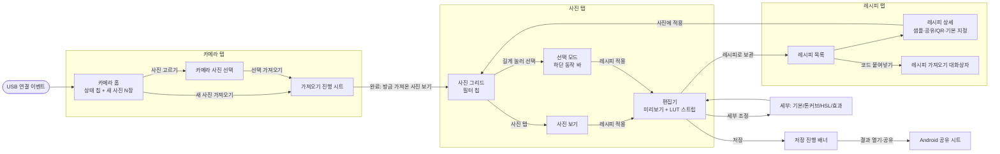

# D1 정보 구조(IA) 제안

근거: [RESEARCH.md](RESEARCH.md) §1 문제 P1–P12, §6 원칙.

## 1. 최상위 내비게이션 (4개 목적지)

| 탭 | 아이콘(Material Symbols) | 목적 | 현재 대응 |
|---|---|---|---|
| **카메라** | `photo_camera` | 연결 상태 + 새 사진 가져오기(앞으로 원격 촬영·BLE 위치 자리) | 홈 + 가져오기 통합 |
| **사진** | `photo_library` | 가져온 원본 라이브러리, 선택→레시피 적용 | 라이브러리 |
| **레시피** | `palette` | 보관 레시피·LUT 탐색, 공유/QR, 기본 레시피 | 편집기 하단 `RecipeManager` 분리 |
| **설정** | `settings` | 가져오기 방식, 자동 레시피, 진단 | 설정(홈 중복 카드 제거) |

- 접힘(Compact): 하단 `NavigationBar`. 펼침(Medium/Expanded): 좌측 `NavigationRail`. (`NavigationSuiteScaffold` 사용 여부는 결정 Q3)
- 편집기는 탭이 아닌 **전체 화면 목적지**(사진 탭 위에 push). 시스템/예측형 뒤로가기로 닫힘.
- 앱 시작 탭: 카메라가 USB로 연결돼 있으면 **카메라**, 아니면 **사진**(마지막 탭 기억은 결정 Q2).

## 2. 화면 흐름

## 3. 화면 명세

각 화면: 목적 / 주 동작(Filled 1개) / 보조 동작 / 빈·진행·오류 상태. 와이어프레임은 `wireframes/`.

### 3.1 카메라 홈 (`01-camera`)
- 목적: 연결 확인과 새 사진 가져오기를 한 번에.
- 주 동작: **새 사진 N장 가져오기**(이미 가져온 항목 제외 수).
- 보조: 사진 골라서 가져오기, 다시 스캔. 하단 회색 자리: "원격 촬영(예정)", "위치 연동(예정)" 비활성 카드.
- 상태
  - 미연결(빈): 일러스트 대신 3단계 체크리스트 "카메라 켜기 → USB 연결 → MTP 모드" + `USB 권한 요청` 버튼.
  - 권한/MTP 오류: 오류 배너 + `다시 연결`.
  - 새 사진 0장: "모두 가져왔어요" + `사진 탭 열기`.
  - 진행: 하단 진행 시트(`n/m`, 남은 장수, `취소`), 다른 탭으로 이동 가능(WorkManager 알림 유지).
  - 중단 이력: "중단된 가져오기 12장" 배너 + `이어서 받기`.

### 3.2 카메라 사진 선택 (`02-camera-pick`)
- 목적: 일부만 가져오기. 날짜별 그룹, 기본으로 **새 사진만 선택된 상태**.
- 주 동작: **N장 가져오기**(하단 고정 바). 보조: 전체 선택/해제, RAW+JPEG 쌍 배지, 가져온 항목 체크 표시.
- 펼침: 그리드 열 증가(140dp adaptive → 접힘 3열, 펼침 6열 근사).

### 3.3 사진 그리드 (`03-library`)
- 목적: 가져온 원본 탐색과 레시피 적용 대상 선택.
- 필터 칩: 전체 · 미편집 · 편집됨 · RAW.  상단 오른쪽 `선택`.
- 주 동작(선택 모드): **레시피 적용**. 보조: 공유, 선택 해제.
- 펼침: **list-detail** — 왼쪽 그리드, 오른쪽 선택 사진 큰 미리보기 + 적용된 레시피·저장 결과 목록.
- 빈: "아직 가져온 사진이 없어요" + `카메라 탭으로`.
- 진행: 레시피 저장 진행은 공용 진행 배너(상단, 고정).

### 3.4 편집기 (`04-editor`)
- 목적: 레시피(LUT) 고르고 강도 조절, 저장.
- 레이아웃(접힘): 상단 앱바(뒤로 · 실행취소 · 다시 · **저장**) / 미리보기(남는 높이 전부, 길게 눌러 원본) / 카테고리 칩 / LUT 썸네일 스트립 / 강도 슬라이더 / `세부 조정` 버튼.
- 여러 장 선택 시 앱바 제목 "3장에 적용", 저장 버튼 "3장 저장", 미리보기 아래 썸네일 페이저.
- 펼침: **supporting pane** — 왼쪽 미리보기(60%), 오른쪽 패널(LUT 그리드 + 세부 조정 상시 표시).
- 테이블탑: 힌지 위 미리보기, 힌지 아래 스트립·슬라이더.
- 상태: 미리보기 렌더 중 = 미리보기 위 얇은 선형 진행; 렌더 실패 = 미리보기 자리에 오류 카드 + `다시 시도`; RAW = "카메라 내장 JPEG로 편집" 정보 칩.

### 3.5 세부 조정 (`05-adjust`)
- 목적: 기본/톤커브/HSL/효과 세부.
- 접힘: 편집기 하단 영역이 **도구 시트**로 교체(미리보기는 위에 유지, 높이 축소). 상단 세그먼트 버튼 4개.
- 각 슬라이더: 라벨 왼쪽·값 오른쪽 위에 숫자, 기본값 눈금, `초기화` 아이콘 버튼(더블탭 초기화는 보조로 유지).
- 효과 탭은 그룹(그레인 / 비네트 / 스플릿 톤) 접기.

### 3.6 레시피 목록 (`06-recipes`)
- 목적: 보관 레시피 관리. 카드 = 샘플 썸네일(최근 적용 사진) + 이름 + LUT 이름 + 즐겨찾기 별.
- 주 동작: **코드로 가져오기**(FAB 대신 상단 버튼; 결정 Q4). 기본 레시피는 상단 고정 카드 + "자동 적용 켬/끔" 스위치.
- 펼침: list-detail(오른쪽 상세: 파라미터 요약, `공유/QR`, `기본으로`, `이름 변경`, `복제`, `삭제`).
- 빈: "편집기에서 '레시피로 보관'을 누르면 여기에 모여요".
- 오류: LUT 누락 레시피는 경고 배지 + `LUT 연결`.

### 3.7 저장·진행·오류 (`07-progress`)
- 공용 **작업 배너**: 가져오기/레시피 저장 모두 같은 컴포넌트(아이콘 · 제목 · `n/m` · 진행 바 · `취소`/`재개`).
- 완료 스낵바: "5장 저장됨 · 보기".
- 오류 배너: 원인 1줄 + 회복 버튼 1–2개(재시도 / 설정 열기 / 진단 로그 공유).

### 3.8 설정 (`08-settings`)
- 섹션: 가져오기(raw PTP 스위치, 저장 위치 안내) · 레시피(자동 적용, 기본 레시피 링크) · 위치 연동(예정, 비활성) · 진단(로그 공유) · 정보(버전, 라이선스: Material Symbols Apache-2.0, LUT 출처 링크).

## 4. 폴더블 레이아웃 규칙

| 창 상태 | 판정 | 내비 | 사진 그리드 | 편집기 |
|---|---|---|---|---|
| 접힘(커버) | width < 600dp | 하단 바 | 3열 | 단일 열: 미리보기 위·도구 아래 |
| 펼침 세로 | 600–840dp | 레일 | list-detail(그리드 + 상세) | supporting pane 2분할 |
| 펼침 가로 | ≥ 840dp | 레일 | list-detail, 그리드 열 증가 | supporting pane, 패널 고정 폭 360dp |
| 테이블탑 | FoldingFeature HALF_OPENED + 수평 힌지 | 숨김(뒤로만) | 해당 없음 | 힌지 위 미리보기, 아래 컨트롤 |

- 힌지 영역에 버튼·텍스트를 두지 않는다(가이드: 힌지를 구분선으로 사용).
- 접힘↔펼침 전환 시 선택 상태·편집 중 레시피·스크롤 위치 유지(`rememberSaveable`).
